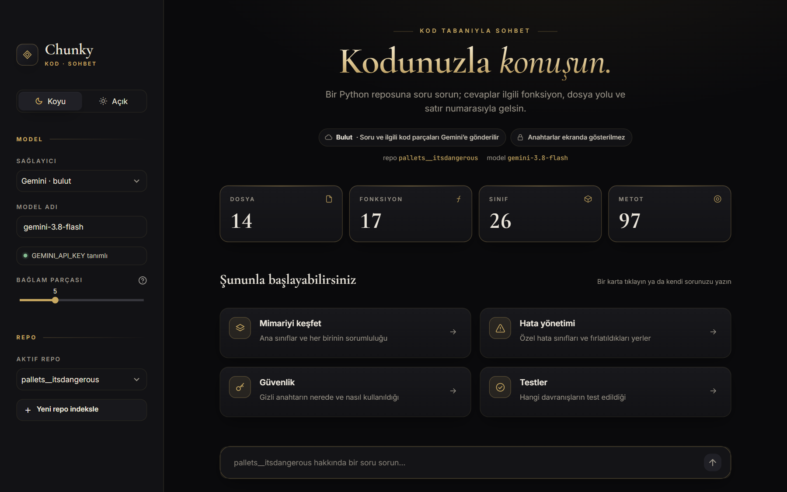
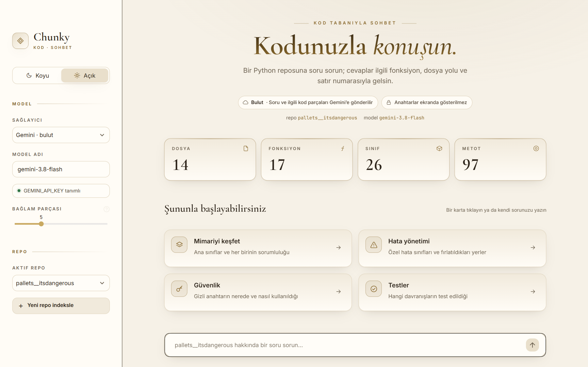
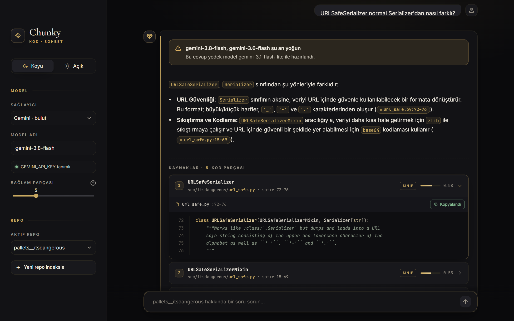
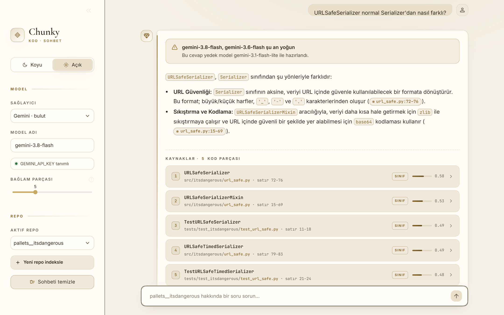

# ◆ Chunky · Kod Tabanıyla Sohbet

Bir GitHub reposunu klonlayıp kodu **fonksiyon ve sınıf bazında** parçalayan, bu parçaları vektör veritabanına indeksleyen ve sorularınızı **dosya yolu ve satır numarası** göstererek cevaplayan bir RAG (Retrieval-Augmented Generation) eğitim projesi.

> **Sürüm 2.0** · Yalnızca **Python** repolarını destekler · Vektör veritabanı: Qdrant · Karma arama (anlam + kelime) · Türkçe ve İngilizce sorular



<details>
<summary><b>Diğer ekran görüntüleri</b> (açık tema, sohbet ve kaynak kartları)</summary>

| Açık tema | Sohbet (koyu) | Sohbet (açık) |
|---|---|---|
|  |  |  |

</details>

## Nasıl çalışır?

```
GitHub URL ──► Klonla ──► .py dosyalarını filtrele ──► tree-sitter ile AST chunking
                                                               │
                                    Çok dilli embedding + BM25 ◄─┘
                                                  │
                                                  ▼
Soru ──► Karma arama (Qdrant: anlam + kelime, RRF ile birleştirme)
            │
            └──► En ilgili kod parçaları + soru ──► LLM ──► Kaynaklı cevap
```

1. **Klonlama:** Repo `repos/` klasörüne yüzeysel (`depth=1`) klonlanır. `.git`, `node_modules`, `venv`, `__pycache__`, `build`, `dist` gibi klasörler atlanır.
2. **AST chunking:** [tree-sitter](https://tree-sitter.github.io/) her dosyayı sözdizimi ağacına çevirir. Her fonksiyon, her metot ve her sınıf başlığı ayrı bir parça olur. İmport ve sabitler gibi geri kalan kod da "modül" parçası olarak saklanır. Her parça için kod metni, dosya yolu, başlangıç/bitiş satırı, ad ve tür tutulur.
3. **İndeksleme:** Her parça [Qdrant](https://qdrant.tech/)'a **iki vektörle** yazılır:
   - **anlam**: çok dilli embedding modeli (`paraphrase-multilingual-MiniLM-L12-v2`). Türkçe bir soru İngilizce yazılmış kodla eşleşebilir.
   - **kelime**: BM25 seyrek vektörü. `URLSafeSerializer` gibi tam adları kaçırmaz.

   Her parçaya ayrıca `is_test` ve `kind` bilgisi eklenir; böylece "test dosyalarını hariç tut" gibi filtreler veritabanında uygulanır. Modeller [FastEmbed](https://github.com/qdrant/fastembed) ile **yerelde** çalışır; bu adım için API anahtarı gerekmez ve kodunuz dışarı gönderilmez.
4. **Karma arama:** Soru iki yöntemle de aranır, sonuçlar Qdrant'ın **RRF** (Reciprocal Rank Fusion) yöntemiyle tek listede birleştirilir. Her kaynak kartında parçanın hangi yöntemle bulunduğu (**anlam + kelime**, **anlam** ya da **kelime**) rozet olarak gösterilir.
5. **Cevaplama:** En ilgili parçalar seçilen LLM'e bağlam olarak verilir. LLM'den her bilgi için `dosya.py:satır-satır` kaynağı vermesi istenir.

## Teknolojiler

| Alan | Teknoloji |
|---|---|
| Dil | Python 3.12+ (3.14 ile test edildi) |
| Kod ayrıştırma | tree-sitter, tree-sitter-python |
| Vektör veritabanı | Qdrant 1.20 (Docker), qdrant-client |
| Embedding | FastEmbed: paraphrase-multilingual-MiniLM-L12-v2 (çok dilli) + BM25 (yerel, ONNX) |
| LLM | Claude (Anthropic), Gemini (Google) veya Ollama (yerel) |
| Arayüz | Streamlit, Pygments (kod renklendirme) |
| Yazı tipleri | Cormorant Garamond, Inter, JetBrains Mono (projeye gömülü, OFL lisanslı) |
| Diğer | GitPython, python-dotenv, PyYAML, httpx, truststore |

## Klasör yapısı

```
chunky/
├── app.py              # Streamlit arayüzü
├── cli.py              # Komut satırı aracı (index / search / ask / list)
├── config.yaml         # LLM sağlayıcısı, model adları ve ayarlar
├── assets/style.css    # Tüm arayüz stilleri; koyu/açık tema renkleri en üstte
├── static/fonts/       # Yerel yazı tipleri (internet/CDN gerekmez) + lisansları
├── .streamlit/         # Streamlit tema ve sunucu ayarları
├── .env.example        # Örnek ortam değişkenleri (sahte değerler)
├── Dockerfile          # Docker imajı
├── compose.yaml        # docker compose ayarları (port, volume, .env)
├── certs/              # İsteğe bağlı ek kök sertifikalar (makineye özel, git'e girmez)
├── eval/               # Arama kalitesi ölçümü (soru seti + ölçüm betiği)
├── requirements.txt
└── src/
    ├── config.py       # config.yaml ve .env okuma
    ├── repo_loader.py  # Klonlama ve dosya filtreleme
    ├── chunker.py      # tree-sitter ile AST chunking
    ├── indexer.py      # Qdrant indeksleme ve karma arama
    ├── llm.py          # claude | gemini | ollama katmanı
    ├── rag.py          # Bağlam oluşturma ve cevaplama
    └── ui.py           # Arayüz HTML parçaları ve simgeler
```

## Kurulum

```bash
git clone https://github.com/fundaberfindemir/CHUNKY.git
cd CHUNKY

# Sanal ortam (Windows)
py -m venv .venv
.venv\Scripts\activate

# Sanal ortam (macOS / Linux)
python3 -m venv .venv
source .venv/bin/activate

pip install -r requirements.txt
```

### API anahtarları

```bash
# Windows
copy .env.example .env
# macOS / Linux
cp .env.example .env
```

`.env` dosyasını açıp **kullanacağınız sağlayıcının** anahtarını yazın. Varsayılan sağlayıcı Gemini'dir; anahtarı [Google AI Studio](https://aistudio.google.com/apikey) üzerinden ücretsiz alabilirsiniz. Ollama kullanıyorsanız anahtar gerekmez.

> 🔒 `.env` dosyası `.gitignore` içindedir ve GitHub'a gönderilmez. Anahtarlar yalnızca bu dosyadan okunur; kodda, loglarda veya arayüzde gösterilmez.

### LLM sağlayıcısını seçme

`config.yaml` içinde:

```yaml
llm:
  provider: gemini          # claude | gemini | ollama
  models:
    claude: claude-sonnet-5-5
    gemini: gemini-3.8-flash
    ollama: qwen2.5-coder:7b
  # Asıl model yoğunsa sırayla denenecek yedek modeller
  fallback_models:
    gemini: [gemini-3.6-flash, gemini-3.1-flash-lite]
```

Ollama için önce [Ollama'yı kurun](https://ollama.com) ve modeli indirin: `ollama pull qwen2.5-coder:7b`.

### Vektör veritabanı (Qdrant)

Qdrant Docker ile çalışır. Uygulamayı Docker olmadan çalıştıracaksanız önce yalnızca Qdrant'ı başlatın:

```bash
docker compose up -d qdrant
```

Arama ayarları `config.yaml` içindedir:

```yaml
vector_db:
  url: http://localhost:6333
  dashboard: http://localhost:6333/dashboard
  dense_model: sentence-transformers/paraphrase-multilingual-MiniLM-L12-v2
  sparse_model: Qdrant/bm25
search:
  top_k: 5
  exclude_tests: false   # true: test dosyaları varsayılan olarak aramaya katılmaz
```

Embedding modelleri (~240 MB) ilk indekslemede bir kez indirilir ve `.models/` klasöründe saklanır (git'e girmez).

## Çalıştırma

### Arayüz (Streamlit)

```bash
streamlit run app.py
```

Tarayıcıda `http://localhost:8501` açılır. Sol menüdeki **Yeni repo indeksle** bölümüne bir GitHub URL'si girip **Klonla ve indeksle** düğmesine basın. Ardından ana ekrandaki örnek sorulardan birine tıklayın ya da kendi sorunuzu yazın.

**Arayüz özellikleri**

- **Koyu / Açık tema:** Sol menünün en üstünden tek tıkla değişir, oturum boyunca hatırlanır.
- **Gizlilik rozetleri:** Yerel sağlayıcıda (Ollama) yeşil "Yerel · Kodunuz bilgisayarınızdan çıkmaz", bulut sağlayıcıda nötr "Bulut" rozeti görünür.
- **İstatistik kartları:** Açılışta reponun dosya, fonksiyon, sınıf ve metot sayıları sayarak belirir.
- **Akan cevap:** Cevap, model yazdıkça parça parça ekrana gelir.
- **Kaynak rozetleri:** Cevaptaki `dosya.py:10–20` atıfları küçük rozetlere dönüşür; tıklayınca ilgili kaynak kartı açılır.
- **Kaynak kartları:** Varsayılan kapalıdır. Başlıkta fonksiyon adı, dosya yolu, satır aralığı, **eşleşme türü rozeti** (anlam + kelime / anlam / kelime) ve anlam benzerliği çubuğu; açılınca gerçek satır numaralı, renklendirilmiş kod ve **Kopyala** düğmesi.
- **Testleri hariç tut:** Sol menüdeki anahtar açıkken test dosyalarındaki kodlar aramaya katılmaz.
- **Qdrant paneli:** Sol menüdeki düğme Qdrant'ın kendi panelini (`http://localhost:6333/dashboard`) açar; koleksiyonları, parçaları ve vektörleri buradan inceleyebilirsiniz.
- **İndeksleme ilerlemesi:** "Repo indiriliyor → Dosyalar okunuyor → Parçalanıyor → İndeksleniyor" adımları ve yüzde göstergesi.
- **Mobil uyumlu:** Dar ekranda kartlar tek sütuna iner, kenar çubuğu üstteki düğmeyle açılır.

Tüm stiller [assets/style.css](assets/style.css) dosyasındadır. Renkler dosyanın başında iki blok halinde (koyu ve açık) CSS değişkenleriyle tanımlanır; bir rengi değiştirmek için sadece orayı düzenlemek yeterlidir.

### Docker ile

[Docker Desktop](https://www.docker.com/products/docker-desktop/) açıkken proje klasöründe:

```bash
docker compose up -d --build
```

Ardından `http://localhost:8501` adresini açın.

- **Anahtarlar imaja girmez.** `.dockerignore` `.env` dosyasını dışarıda bırakır; `compose.yaml` anahtarları yalnızca konteyner çalışırken `.env`'den verir.
- **Sadece bu bilgisayardan erişilir.** Port `127.0.0.1`'e bağlıdır, yerel ağa açılmaz.
- **İki servis:** `chunky` (arayüz) ve `qdrant` (vektör veritabanı). Qdrant paneli `http://localhost:6333/dashboard` adresindedir.
- **Veriler kalıcıdır.** İndeksler `qdrant-data`, klonlanan repolar `chunky-repos` volume'unda tutulur; konteyner silinse de kaybolmaz.
- **Modeller imajdadır.** Embedding modelleri derleme sırasında indirilir; ilk indekslemede beklemezsiniz.
- **Ollama:** Bilgisayarınızda çalışan Ollama'ya konteynerden `host.docker.internal` üzerinden ulaşılır.
- Uygulama konteynerde root olmayan `app` kullanıcısıyla çalışır.

Sık kullanılan komutlar:

```bash
docker compose logs -f                 # kayıtları izle
docker compose up -d --force-recreate  # .env değiştiyse yeni anahtarla yeniden başlat
docker compose down                    # durdur (veriler kalır)
docker compose down -v                 # durdur ve indeksleri de sil
```

> **Antivirüs / kurumsal ağ:** Derlemede `CERTIFICATE_VERIFY_FAILED` hatası alırsanız, HTTPS trafiğini denetleyen yazılımın kök sertifikasını `certs/` klasörüne koyun. Ayrıntılar: [certs/README.md](certs/README.md).

### Komut satırı

```bash
# Repoyu klonla ve indeksle
python cli.py index https://github.com/pallets/itsdangerous

# İndekslenmiş repoları listele
python cli.py list

# Sadece karma arama (LLM kullanmaz); --no-tests test dosyalarını dışarıda bırakır
python cli.py search pallets__itsdangerous "base64 helpers" -k 5 --show-code
python cli.py search pallets__itsdangerous "imza nasıl doğrulanıyor?" --no-tests

# LLM ile kaynaklı cevap
python cli.py ask pallets__itsdangerous "max_age süresi nasıl kontrol ediliyor?"
python cli.py ask pallets__itsdangerous "How are keys rotated?" --provider ollama
```

Çıktıda her sonucun anlam benzerliği (yalnızca kelimeyle bulunduysa `-`) ve eşleşme türü yazar.

## Arama kalitesini ölçme

`eval/sorular.yaml` dosyasında `pallets/itsdangerous` için cevabı bilinen 12 soru (6 Türkçe, 6 İngilizce) vardır. Ölçüm betiği her soru için doğru kod parçasının kaçıncı sırada geldiğine bakar:

```bash
python cli.py index https://github.com/pallets/itsdangerous
python -m eval.olcum
```

| | v1.0 (ChromaDB, İngilizce model) | v2.0 (Qdrant, çok dilli + karma) |
|---|---|---|
| Türkçe sorular · ilk 5'te | %0 | **%100** |
| İngilizce sorular · ilk 5'te | %100 | %100 |
| Tüm sorular · MRR | 0.36 | **0.59** |

*İlk 5'te: doğru parça LLM'e gönderilen 5 parçanın içinde mi? MRR: doğru parçanın sırasının tersi ortalaması (1. sıra = 1, 2. sıra = 0.5 …).*

## Örnek sorular

`pallets/itsdangerous` reposu için:

- İmzanın süresi dolduğunda hangi hata fırlatılıyor?
- `TimestampSigner` zaman damgasını nereye ekliyor?
- Birden fazla gizli anahtar (key rotation) nasıl destekleniyor?
- `URLSafeSerializer` normal `Serializer`'dan nasıl farklı?
- base64 kodlama ve çözme fonksiyonları nerede?
- `max_age` parametresi hangi testlerde kullanılıyor?

## Bilinen sınırlamalar

- Yalnızca Python dosyaları indekslenir.
- Embedding modeli uzun parçaların yalnızca başını dikkate alır. Bu yüzden parçaların başına dosya yolu ve ad eklenir.
- Sohbet hafızası yoktur; her soru bağımsız cevaplanır.

## Sorun giderme

- **Qdrant'a bağlanılamıyor:** `docker compose up -d qdrant` ile veritabanını başlatın. Adres `config.yaml` içindeki `vector_db.url` (Docker'da `QDRANT_URL`) değeridir.
- **`CERTIFICATE_VERIFY_FAILED` hatası:** Antivirüs veya kurumsal ağ HTTPS trafiğini denetliyor olabilir. Proje `truststore` ile işletim sisteminin sertifika deposunu kullanır; `pip install -r requirements.txt` ile kurulu olduğundan emin olun.
- **"Gemini anahtarı kabul edilmedi":** Anahtarı [aistudio.google.com/apikey](https://aistudio.google.com/apikey) adresindeki **Copy** düğmesiyle eksiksiz kopyalayın. Docker kullanıyorsanız ardından `docker compose up -d --force-recreate` çalıştırın.
- **"Gemini şu an çok yoğun" / "yedek model ile hazırlandı":** Google tarafında geçici yoğunluk (HTTP 503). Uygulama bu durumda `config.yaml` içindeki `fallback_models` listesindeki modelleri sırayla dener.
- **"Gemini için API anahtarı bulunamadı":** `.env` dosyası yok ya da anahtar boş. Ekledikten sonra uygulamayı yeniden başlatın.
- **"Model boş bir cevap döndürdü":** `config.yaml` içindeki `max_tokens` değerini artırın.
- **"Ollama'ya bağlanılamadı":** Ollama uygulaması açık değil ya da `OLLAMA_HOST` yanlış.
- **Stil değişikliği görünmüyor:** `src/` altındaki Python dosyalarını değiştirdiyseniz Streamlit'i yeniden başlatın; yalnızca `assets/style.css` değiştiyse sayfayı yenilemek yeterlidir.

## Sürümler

- **v1.0**: Python desteği, AST chunking (tree-sitter), ChromaDB, Gemini / Claude / Ollama, yedek model zinciri, koyu/açık temalı Streamlit arayüzü, Docker.
- **v2.0**: ChromaDB yerine Qdrant, çok dilli embedding (Türkçe sorularda ilk 5 isabeti %0 → %100), karma arama (anlam + BM25, RRF), "Testleri hariç tut" filtresi, eşleşme türü rozetleri, Qdrant paneli bağlantısı, arama kalitesi ölçümü (`eval/`).
- **Planlanan**: sohbet hafızası, repo silme/güncelleme, diğer programlama dilleri.

## Lisans

[MIT](LICENSE). Projeye gömülü yazı tipleri kendi açık lisanslarıyla (SIL OFL 1.1) dağıtılır; lisans metinleri `static/fonts/` klasöründedir.
